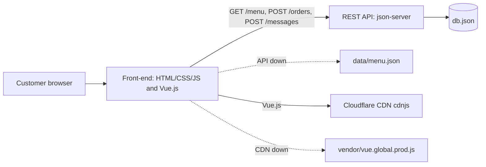
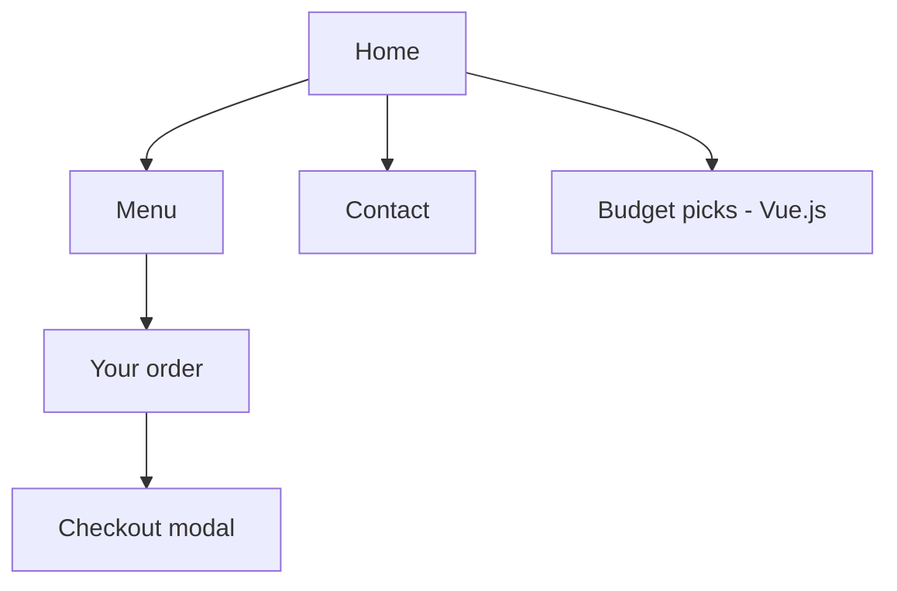

# Barako Brew Cafe — Front-End

Version 1.0 · <date> · Author: <your name>

Menu and ordering website for Barako Brew Cafe, Lipa City: a vanilla JavaScript site with a small Vue.js feature (Budget picks), using a REST API (mock API for now).

## 1. Target audience

- **Developers and the back-end team:** setup, architecture, API (sections 3, 4, 6, 7).
- **Café staff and owner:** how to use the site (docs/USER-GUIDE.md).
- **Project manager / assessor:** scope, features, test results (docs/TEST-PLAN.md).

## 2. Scope of this documentation

Covers the website (`index.html` with its vanilla JavaScript and Vue.js parts), the mock API (`db.json`) and the release build (`release/`).
Does not cover the future real back-end, hosting or online payment.

## 3. System architecture

Three tiers:

1. **Presentation:** semantic HTML5 styled with Bootstrap 5.3.3 (local copy in `vendor/bootstrap/`) plus a small `css/style.css` for the brand; vanilla JavaScript (`js/app.js`); one Vue.js 3 component, Budget picks (`js/vue-app.js`).
2. **Web service:** REST API, JSON over HTTP. json-server now, real back-end later. If the API is down, both pages read `data/menu.json`.
3. **Data:** `db.json` now, a database later.

Vue.js is loaded from the Cloudflare CDN (cdnjs), with a local fallback in `vendor/`.

## 4. Installation and setup

Requirements: Node.js LTS, Git, VS Code with the Live Server extension, a modern browser.

1. `git clone D:/DEMO/remote/barako-brew.git`
2. `npm install -g json-server@0.17.4`
3. `json-server --watch db.json --port 3000`
4. Open `index.html` with **Live Server** (right-click → *Open with Live Server*). Don't double-click it: `fetch()` needs `http://`, not `file://`.
5. Offline: the page still works with no internet. Data comes from `data/menu.json` and Vue from `vendor/`.
6. Production build: `release.ps1` (Windows) or `sh release.sh` (macOS/Linux), then `http-server release -p 8081`.

Configuration: change `API_URL` in `js/app.js` and `PICKS_API` in `js/vue-app.js` to the real back-end URL, and update `connect-src` in the CSP.

## 5. Features and functionalities

| Feature | How it works |
|---|---|
| Menu from the API | `loadMenu()` calls GET /menu; falls back to `data/menu.json` |
| Category filter and search | buttons and the search box set the state, then `renderMenu()` redraws; the last category is kept in a SameSite cookie |
| Order panel | a `Cart` class (object-oriented) keeps items and quantities and computes subtotal, discount and total; − / + / quantity box / Remove; sold-out items are disabled |
| Senior citizen / PWD discount | checkbox; 20% off the subtotal when ticked and the cart is not empty |
| Checkout | Bootstrap modal; pickup name and time validated (`validatePickup()`: today, 7:00–21:00, 15 minutes ahead); POST /orders |
| Contact form | validation, RA 10173 consent, CSRF token, POST /messages |
| Budget picks (Vue.js) | a price slider that lists available items up to that price; reactive state with `ref` and `computed` |
| Responsive layout | Bootstrap 5 grid (mobile-first): menu cards 1 / 2 / 3 per row below 768 px / from 768 px / from 992 px; navbar collapses below 768 px; order lines and summary side by side from 992 px |
| Accessibility | semantic landmarks under the Bootstrap classes, labels, skip link (`visually-hidden-focusable`), visible focus, `aria-expanded` (navbar), `aria-pressed` (filters), `aria-invalid` + `invalid-feedback` (forms) |
| Security | strict Content Security Policy (Vue uses a render function, so no `unsafe-eval`), output encoding, input validation, CSRF token, session timeout |
| Performance | WebP images, lazy loading, `defer`, minified release, CDN with local fallback |

## 6. API endpoints

Base URL: `http://localhost:3000` (details in docs/API.md; tested with `api.http` and the REST Client extension).

| Method | Endpoint | Purpose | Body | Success | Errors |
|---|---|---|---|---|---|
| GET | /menu | List menu items | – | 200, JSON array | 500 |
| GET | /menu?category=Hot | Filter by category | – | 200, JSON array | 500 |
| GET | /menu/:id | One item | – | 200, JSON object | 404 |
| POST | /orders | Place an order | {items: [{id, qty}], subtotal, discount, total, pickupName, pickupTime, date} + header X-CSRF-Token | 201, created object | 400, 500 |
| POST | /messages | Send a contact message | {name, email, message, date} + header X-CSRF-Token | 201, created object | 400, 500 |

Checked on <date>: every endpoint returns the documented status code.

## 7. Code documentation

- Every JavaScript file starts with a header comment that states its purpose.
- Functions use JSDoc comments (`/** ... @param ... @returns */`), which documentation generators such as Doxygen can read.
- CSS sections are labelled with comments.

## 8. System diagrams

Architecture:



Sitemap:



## Folder structure

```
index.html, css/style.css, js/app.js   vanilla JavaScript site
js/vue-app.js                           Budget picks, built with Vue.js
vendor/bootstrap/                       Bootstrap 5.3.3 CSS and JS (local, works offline)
vendor/vue.global.prod.js               local Vue.js (CDN fallback)
data/menu.json, db.json, api.http       local data, mock API, API tests
images/                                 optimised WebP images
originals/                              original large images (before optimisation)
docs/                                   plan, risks, tests, API, performance, user guide
release.ps1, release.sh                 build the minified release/ folder
```
